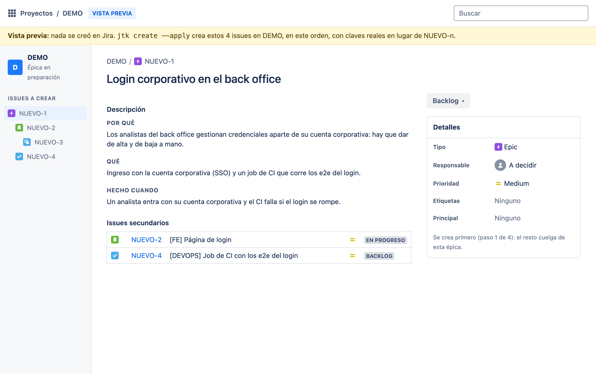

# jira-team-kit

Skills para Claude Code, Codex y Cursor, y un CLI (`jtk`), para trabajar con Jira Cloud sin salir del editor. Son
cuatro, y cada una responde a algo distinto que le pedís al agente:

| Le decís al agente… | Y la skill… |
|---|---|
| *«Creame una épica para esto que estuvimos trabajando»* | arma la épica con sus historias, tareas y subtareas, la deja como kanban local y la mantiene sincronizada con Jira |
| *«¿Qué hice ayer?»*, *«¿qué puedo hacer esta semana?»*, *«¿en qué estoy bloqueado?»* | te lo responde leyendo Jira en vivo, sin escribir nada |
| *«¿Cómo viene mi equipo?»*, *«¿qué está estancado?»* | resume el estado de uno o varios boards y de un equipo, sin escribir nada |
| *«Pasá estos tickets a en curso»*, *«asigná los que no tienen dueño»* | prepara el cambio sobre varios issues a la vez, para que una persona lo apruebe |

**Todo lo que escribe en Jira pasa por una vista previa y por un clic humano de aprobación; todo lo demás es de solo
lectura.** La aprobación es un clic tuyo, no del agente (con los [límites](docs/referencia.md#cambiar-varios-issues-a-la-vez-con-guarda) que la referencia explica).

## Elegí por dónde empezar

| Skill | Qué resuelve | Jira | Se instala con | Showcase | Instalación |
|---|---|---|---|---|---|
| **`jira-team-kit`** | Crear una épica desde la conversación y mantenerla como kanban local (`pull` / `push`) | Escribe, con tu aprobación | `./install.sh --with-write` | [Ver el caso](docs/showcase.md#1-crear-una-épica-desde-la-conversación) | [Instalar](docs/instalacion.md#1-instalar) |
| **`jira-standup`** | Qué hice, qué puedo hacer, qué me bloquea, la carga de un compañero y métricas de entrega | Solo lectura | `./install.sh` | [Ver el caso](docs/showcase.md#3-qué-hice-qué-puedo-hacer-qué-me-bloquea) | [Instalar](docs/instalacion.md#1-instalar) |
| **`jira-em`** | Cómo viene el equipo y los boards: estancado, bloqueado, flujo, resumen semanal, mesa de ayuda | Solo lectura | `./install.sh` | [Ver el caso](docs/showcase.md#4-cómo-viene-el-equipo) | [Instalar](docs/instalacion.md#1-instalar) |
| **`jira-em-ops`** | Cambiar varios issues a la vez (estado, responsable, comentario), con un plan y aprobación humana | Escribe, con tu aprobación | `./install.sh --with-write` | [Ver el caso](docs/showcase.md#5-cambiar-varios-issues-con-aprobación-humana) | [Instalar](docs/instalacion.md#1-instalar) |

## Un ejemplo: crear una épica

El agente te devuelve la épica con sus historias, tareas y subtareas, una vista previa navegable con estética de Jira y
el comando para crearla. Lo corrés vos, aprobás en una ventana con el detalle, y recién ahí se escribe. El recorrido
completo está en el [showcase](docs/showcase.md#1-crear-una-épica-desde-la-conversación).



## Qué documento leer

| Si querés… | Leé | Qué encontrás |
|---|---|---|
| **Instalarlo y probarlo, desde Cursor** | [Instalación y primer uso](docs/instalacion.md) | Todo con prompts, sin comandos: instalar, credenciales de Jira, tu primera épica, reportes y cambios en lote, con maquetas de Cursor |
| **Instalarlo comando por comando** | [Instalación detallada](docs/instalacion-detallada.md) | Requisitos, `./install.sh`, credenciales, y el mismo recorrido corriendo cada comando de `jtk`, con capturas de la terminal |
| **Ver todo lo que hace** | [Showcase](docs/showcase.md) | Cada skill en un escenario real: qué le decís al agente, qué comandos corre, qué ves en pantalla |
| **Consultar un comando o un flag** | [Referencia](docs/referencia.md) | Todos los comandos, el formato del spec, asignación, perfiles de board, kanban local, comparación con el MCP de Atlassian |

## En tres comandos

```bash
git clone git@github.com:josefigueredo/jira-team-kit.git jira-team-kit
cd jira-team-kit && ./install.sh --with-write      # enlaza las skills y deja `jtk` en ~/.local/bin
jtk who "tu nombre" --jira-project KEY             # comprueba tus credenciales, sin escribir nada
```

Antes del último comando necesitás [tus credenciales de Jira](docs/instalacion-detallada.md#3-credenciales-de-jira) (tres
variables de entorno). Requisitos: `python3` 3.9 o más (solo biblioteca estándar) y acceso al repo.

## Por qué no simplemente el MCP de Atlassian

Se pisan solo en el CRUD básico. El MCP escribe directo, sin ventana y sin registro local; esta skill hace un dry run por
defecto, pide un clic humano para escribir y deja cada escritura registrada. La
[comparación completa](docs/referencia.md#frente-al-mcp-de-atlassian) y la recomendación (**no instalar el MCP de
Atlassian junto a esta skill**) están en la referencia.

## Desarrollo

```bash
python3 -m unittest discover -s tests          # con Jira falso: nunca sale a la red
/usr/bin/python3 -m unittest discover -s tests # verifica compatibilidad con 3.9
```

La tabla de módulos de `jkan/` está en la [referencia](docs/referencia.md#desarrollo).
