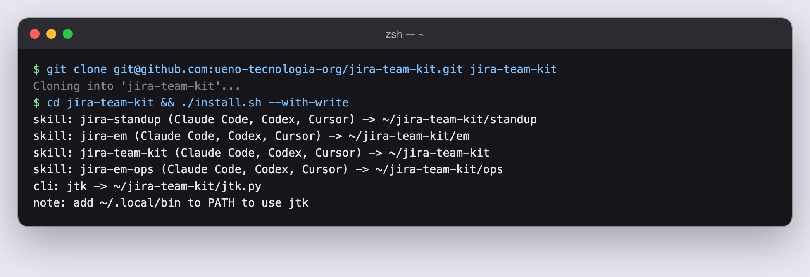
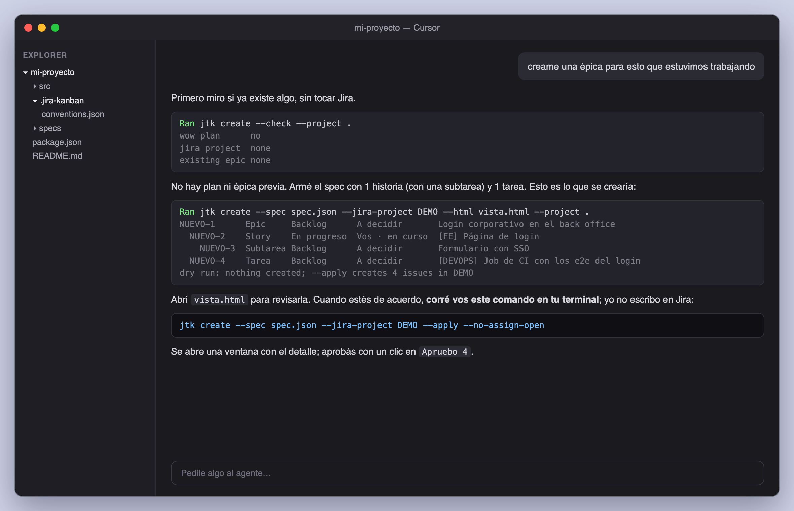
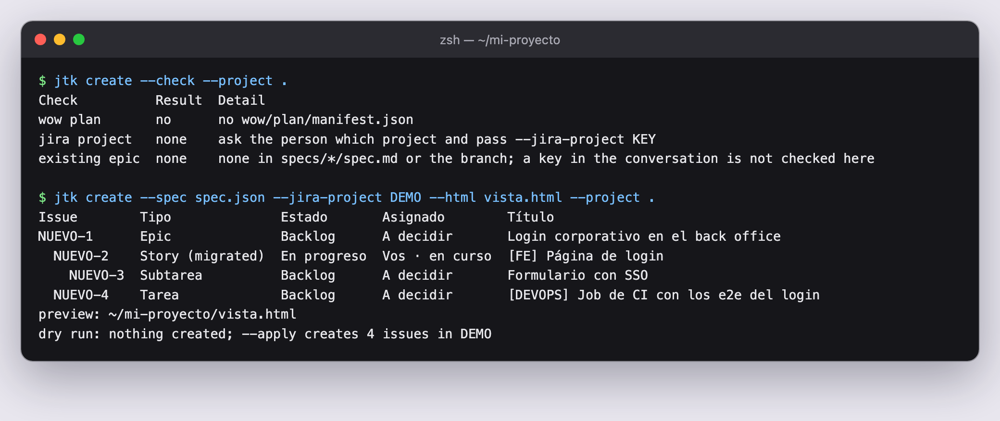
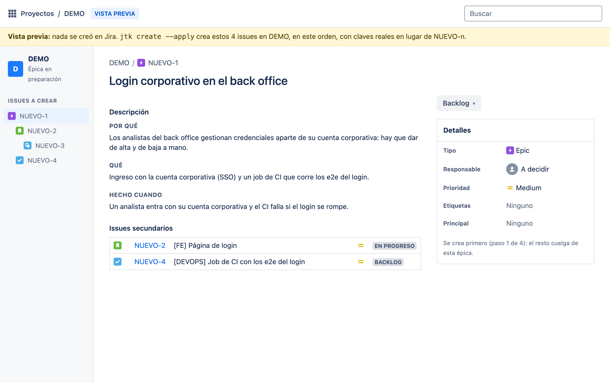
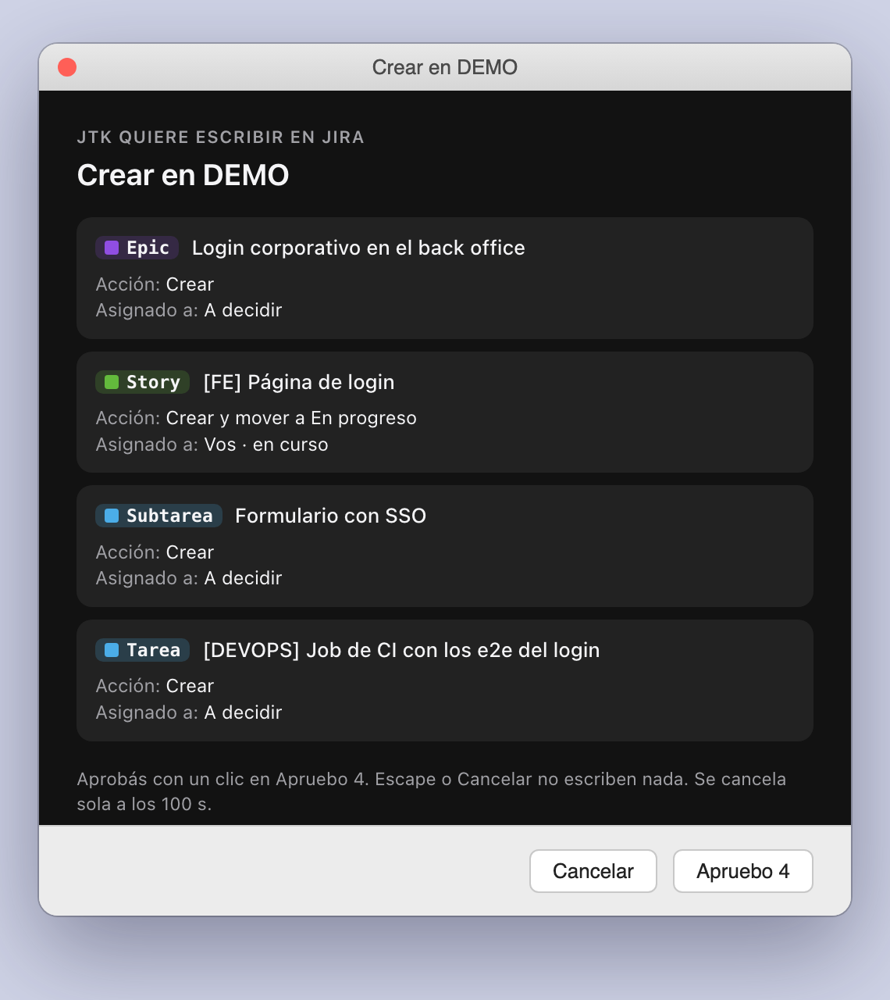
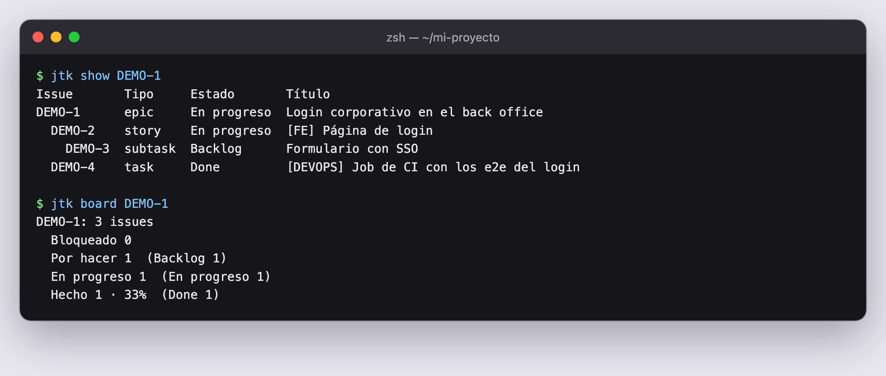

# Instalación detallada: comando por comando

> **¿Solo vas a usarlo desde Cursor?** Tenés la [instalación simple](instalacion.md), que usa solo prompts. Esta guía
> es para quien quiere ver (o correr) cada comando de `jtk`, o instalarlo sin un agente.

Diez minutos para dejar `jtk` y sus skills andando en Claude Code, Codex y Cursor, y crear tu primera épica con una
vista previa antes de escribir nada en Jira. Después de esto, el [showcase](showcase.md) muestra todo lo que se puede
hacer y la [referencia](referencia.md) tiene cada comando.

| Paso | Qué hacés | Tiempo |
|---|---|---|
| [1. Requisitos](#1-requisitos) | Comprobar `python3`, `git` y el acceso al repo | 1 min |
| [2. Instalar](#2-instalar) | Clonar y correr `./install.sh` | 2 min |
| [3. Credenciales de Jira](#3-credenciales-de-jira) | Crear un token y guardarlo | 3 min |
| [4. Tu primera épica en Cursor](#4-tu-primera-épica-en-cursor) | Pedírsela al agente | 2 min |
| [5. Lo mismo, comando por comando](#5-lo-mismo-comando-por-comando) | Hacerlo a mano desde la terminal | 5 min |
| [6. Mantenerlo al día](#6-mantenerlo-al-día) | `jtk update` | 1 min |

> **Sobre las capturas.** Las terminales, la vista previa y la ventana de aprobación salen de ejecutar `jtk` de este
> repo sobre un proyecto de prueba, sin credenciales ni red (la vista previa es la página real; la ventana es el HTML
> real de `approval.py` con los botones nativos dibujados al lado). **La captura de Cursor es una maqueta**: muestra
> cómo se ve la conversación, no una sesión grabada. Al final hay una [tabla con el origen de cada imagen](#de-dónde-sale-cada-captura).

---

## 1. Requisitos

| Qué | Para qué | Cómo comprobarlo |
|---|---|---|
| `python3` 3.9 o más | `jtk` usa solo la biblioteca estándar: no hay nada que instalar con `pip` | `python3 --version` |
| `git` y acceso por SSH a `josefigueredo` | El repo es privado | `ssh -T git@github.com` |
| Un sitio de Jira Cloud y una cuenta | `jtk` entra con tu email y un token tuyo | Abrí `https://tu-empresa.atlassian.net` |
| macOS (recomendado) | La ventana de aprobación es nativa de macOS. Sin ella, `--apply` no escribe: imprime el comando y sale con código 3 | — |

## 2. Instalar

```bash
git clone git@github.com:josefigueredo/jira-team-kit.git jira-team-kit
cd jira-team-kit && ./install.sh --with-write
```



*Salida real de `./install.sh --with-write` (las rutas se acortaron a `~/jira-team-kit`).*

Qué hace `install.sh`, y qué no:

- **No copia nada.** Crea enlaces simbólicos que apuntan a tu clon, así que hay una sola fuente de verdad.
- **Cuatro skills.** `./install.sh` a secas instala las dos de solo lectura (`jira-standup`, `jira-em`).
  `--with-write` suma las que escriben en Jira (`jira-team-kit`, `jira-em-ops`). Volver a correrlo nunca quita una skill.
- **Tres runtimes a la vez.** Cada skill queda enlazada en `~/.claude/skills/`, `~/.codex/skills/` y
  `~/.cursor/skills/`, y todas apuntan a `~/.agents/skills/<skill>`.
- **El comando `jtk`** queda en `~/.local/bin/jtk`. Si el script avisa `note: add ~/.local/bin to PATH to use jtk`
  (como en la captura), agregá a tu `~/.zshrc`:

  ```bash
  export PATH="$HOME/.local/bin:$PATH"
  ```

  y abrí una terminal nueva.
- **Nunca pisa un archivo real.** Si donde tiene que ir un enlace ya hay un archivo o carpeta, se detiene con código 1
  y te dice cuál mover.

El nombre de la carpeta del clon no importa: `install.sh` calcula dónde está. Si tu instalación vieja apunta a un clon
llamado `jira-kanban`, sigue andando; para mover todo a `jira-team-kit`, volvé a correr `./install.sh` desde el clon nuevo.

Para comprobar que quedó bien:

```bash
jtk --version
```

```text
jtk 23367a1 2026-10-11
```

Imprime el commit y su fecha. Si dice `command not found`, falta el `PATH` de arriba.

## 3. Credenciales de Jira

Se buscan en este orden, igual que WayOfWork:

1. Variables de entorno: `JIRA_BASE_URL`, `JIRA_EMAIL`, `JIRA_API_TOKEN`.
2. `./.env.local` del proyecto.
3. `./.spec-kit/.env` del proyecto.

### Cómo conseguirlas en una instalación nueva

| Variable | Qué es | De dónde sale |
|---|---|---|
| `JIRA_BASE_URL` | La URL de tu sitio de Jira Cloud, sin barra final: `https://tu-empresa.atlassian.net` | Es la de la barra del navegador cuando abrís Jira |
| `JIRA_EMAIL` | El email de tu cuenta de Atlassian | El que usás para entrar a Jira |
| `JIRA_API_TOKEN` | Un token de API tuyo | [Crear un token de API](https://id.atlassian.com/manage-profile/security/api-tokens) → **Create API token** → nombre y vencimiento (de 1 a 365 días) → **Copy to clipboard**. Se muestra una sola vez. [Guía oficial](https://support.atlassian.com/atlassian-account/docs/manage-api-tokens-for-your-atlassian-account/) |

> **Creá el token sin alcance (el botón «Create API token», no «Create API token with scopes»).** `jtk` llama a la URL de
> tu sitio con autenticación básica (email y token). Un token con alcance solo funciona a través de
> `https://api.atlassian.com/ex/jira/{cloudId}`, que `jtk` no usa: con ese token no entra. Atlassian recomienda los
> tokens con alcance por seguridad (medido en su guía el 2026-10-11); como `jtk` todavía no los soporta, usá el clásico y
> guardalo como un secreto.

Dónde ponerlas, a elección:

```bash
# A) Para todos tus proyectos: en ~/.zshrc (o ~/.bashrc), y abrí una terminal nueva
export JIRA_BASE_URL="https://tu-empresa.atlassian.net"
export JIRA_EMAIL="vos@tu-empresa.com"
export JIRA_API_TOKEN="el-token-que-copiaste"
```

```bash
# B) Para un solo proyecto: las mismas tres líneas, sin `export`, en ./.env.local. Que el archivo esté en .gitignore.
JIRA_BASE_URL=https://tu-empresa.atlassian.net
JIRA_EMAIL=vos@tu-empresa.com
JIRA_API_TOKEN=el-token-que-copiaste
```

Para comprobar que entran **sin escribir nada en Jira**:

```bash
jtk who "tu nombre" --jira-project KEY
```

Es de solo lectura. Responde `unique` (te encontró), `ambiguous` (lista a los candidatos y no elige) o `none`. Si el
token vence, `jtk` deja de poder entrar: creá otro en el mismo link y cambiá la variable.

## 4. Tu primera épica en Cursor

Abrí tu proyecto en Cursor (o Claude Code, o Codex: es la misma skill) y pedile al agente lo que ya hiciste o lo que
vas a hacer:

> creame una épica para esto que estuvimos trabajando



*Maqueta (no es una sesión grabada). Los dos bloques «Ran» son la salida real de esos comandos.*

Lo que pasa, en orden, y por qué es seguro:

1. **Mira antes de redactar.** `jtk create --check` es offline: dice si hay un plan de WayOfWork, qué proyecto de Jira
   aplica y si ya existe una épica para este trabajo. Si ya existe, el agente **te pregunta** antes de crear otra.
2. **Redacta el spec** (un JSON en su carpeta temporal) con la épica, sus historias, tareas y subtareas.
3. **Te muestra el dry run** y genera una vista previa HTML. Hasta acá no se escribió nada en Jira.
4. **Te pasa el comando `--apply` y lo corrés vos.** El agente no escribe en Jira: en Claude Code un hook se lo
   bloquea; en Cursor y Codex lo frenan la ventana de aprobación y las reglas de `AGENTS.md`.
5. **Aprobás con un clic** en una ventana con el detalle (ver el [paso 5.4](#54-crear-en-jira-con---apply)).

## 5. Lo mismo, comando por comando

Esto es lo que hace el agente por vos. Conviene hacerlo una vez a mano para saber qué está pasando. Todos los comandos
aceptan `--project DIR` (por defecto, el directorio actual) y **ninguno escribe en Jira sin `--apply`**.

### 5.1 Mirar antes de redactar

```bash
jtk create --check --project .
```

```text
Check          Result  Detail
wow plan       no      no wow/plan/manifest.json
jira project   none    ask the person which project and pass --jira-project KEY
existing epic  none    none in specs/*/spec.md or the branch; a key in the conversation is not checked here
```

| Fila | Qué significa | Qué hacer |
|---|---|---|
| `wow plan` = `yes` | Las épicas de este trabajo salen de la exportación de Product Brain | No uses esta skill salvo que el trabajo esté fuera de ese plan |
| `jira project` = `none` | No hay un proyecto por defecto | Pasá `--jira-project KEY` en los comandos que siguen |
| `existing epic` = una clave | Hay un `**Jira Epic:** KEY` en `specs/*/spec.md` o la clave está en la rama | Si cubre el trabajo, no crees otra: `jtk pull KEY` la trae |

### 5.2 Escribir el spec

Un archivo `spec.json` con la épica y sus issues. **Cada épica, ítem y subtarea lleva `why`, `what` y `done_when`**: con
una `description` libre, `jtk` se niega. El mínimo:

```json
{
  "epic": {"summary": "Login corporativo en el back office",
           "why": "Los analistas gestionan credenciales aparte de su cuenta corporativa.",
           "what": "Ingreso con la cuenta corporativa (SSO) y un job de CI con los e2e del login.",
           "done_when": "Un analista entra con su cuenta corporativa y el CI falla si el login se rompe."},
  "items": [
    {"type": "story", "area": "FE", "summary": "Página de login",
     "user_story": "Como analista quiero ingresar con mi cuenta corporativa para no gestionar credenciales aparte",
     "why": "Hoy el back office pide un usuario y una clave propios.",
     "what": "Página de login con el botón de SSO corporativo.",
     "done_when": "Un analista sin sesión abre el back office y ve el login.",
     "acceptance": ["AC1: Dado un analista sin sesión Cuando abre el back office Entonces ve el login"],
     "started": true,
     "subtasks": [{"summary": "Formulario con SSO", "why": "El login necesita un formulario.",
                   "what": "Formulario con el botón de SSO.", "done_when": "El botón redirige al proveedor de identidad."}]},
    {"type": "task", "area": "DEVOPS", "summary": "Job de CI con los e2e del login",
     "why": "Nada avisa si el login se rompe antes de producción.",
     "what": "Un job que corre los e2e del login en cada PR.", "done_when": "Un PR que rompe el login queda en rojo."}
  ]
}
```

Lo esencial: `story` solo si alguien se beneficia («Como … quiero … para …»), si no `task`; `area` se vuelve el prefijo
del título (`[FE] …`); `started` y `done` dicen si lo estás haciendo o ya lo hiciste (con `done` hace falta `evidence`).
Todos los campos, con sus reglas, están en [`references/spec.md`](../references/spec.md).

### 5.3 Ver qué se crearía (dry run + vista previa)

```bash
jtk create --spec spec.json --jira-project DEMO --html vista.html --project .
```



*Salida real. Las claves `NUEVO-n` son las del orden de creación; las reales las pone Jira.*

La tabla dice, para cada issue, de qué tipo es, **en qué estado termina** y **a quién queda asignado**. `--html`
genera además una página con la forma de una pantalla de issue de Jira, sin red ni recursos externos. Abrila con
`open vista.html`:



*La página real que genera `--html`. Se navega por `#hash`: el botón Atrás funciona.*

Si el spec está mal (por ejemplo, falta un `why`), el dry run lo dice **antes** de tocar nada y sale sin crear nada.

### 5.4 Crear en Jira con `--apply`

```bash
jtk create --spec spec.json --jira-project DEMO --apply --no-assign-open
```

`--apply` abre una ventana nativa de macOS con el detalle exacto de lo que se va a escribir:



*El cuerpo de la ventana es el HTML real que genera `jtk`; la barra de botones es la nativa, dibujada aparte.*

- **Aprobás con un clic en `Apruebo 4`** (el número es la cantidad de issues). Return **no** aprueba.
- **Cancelar** es el predeterminado y también responde a Escape. Si cancelás, cerrás la ventana o pasan 100 segundos, no
  se escribe nada y el comando sale con código `3`.
- Lo marcado `started` o `done` se crea y después se mueve de estado: esa segunda escritura figura en la ventana
  (`Crear y mover a En progreso`).
- **`--assign-open` o `--no-assign-open` es obligatorio** si hay issues sin terminar: elegís si te los asignás. Sin
  eso, `--apply` se niega antes de llamar a Jira.
- Si Jira rechaza un issue a mitad de camino, conserva lo creado y **el mismo comando retoma sin duplicar**.
- Cada escritura queda en `./.jira-kanban/jira-writes.jsonl`.

### 5.5 El kanban local

Al terminar, `create` escribe una carpeta por issue en `./.jira-kanban/<ÉPICA>/`. Para verlo:

```bash
jtk show DEMO-1      # el árbol
jtk board DEMO-1     # agrupado: Bloqueado · Por hacer · En progreso · Hecho
```



*Salida real sobre un kanban de prueba armado a mano con el mismo formato que escribe `create`.*

### 5.6 Sincronizar con Jira: `pull` y `push`

```bash
jtk pull DEMO-1              # trae la épica y sus hijos de Jira al kanban local
# editá un status, un # título o un cuerpo en .jira-kanban/DEMO-1/…
jtk push DEMO-1              # dry run: lista lo que cambiaría
jtk push DEMO-1 --apply      # lo escribe (con la ventana de aprobación)
```

- **Conflictos:** si el mismo campo cambió también en Jira, `push` lo informa como **conflicto** y no lo pisa. Hacé
  `jtk pull`, volvé a aplicar tu cambio y repetí el `push`.
- **Subtarea nueva:** creá `…/subtasks/_new-<algo>/subtask.md` con un `# título` y las tres secciones (Por qué, Qué,
  Hecho cuando) completas; `push` la crea bajo el padre de esa carpeta y le pone su clave.

### 5.7 Reportes de solo lectura

Leen Jira en vivo y no escriben nada. Las ventanas de tiempo las traduce la CLI (lunes a domingo, en la zona del equipo):

```bash
jtk done --when yesterday        # qué hice, como árbol Épica → Historia/Tarea → Subtarea
jtk next --when this-week        # qué puedo hacer: por prioridad y vencimiento
jtk blocked                      # dónde estoy bloqueado
jtk stats --weeks 6 --by label   # velocidad, lead time, edad del WIP
```

La primera vez, `jtk board setup KEY` guarda el perfil del board (qué estado significa «hecho» en cada proyecto); sin
él, los reportes usan la categoría de Jira y lo avisan arriba con `> ⚠`.

## 6. Mantenerlo al día

```bash
jtk update --check    # no cambia nada: dice si tu instalación es la última
jtk update            # git pull --ff-only
```

`--check` responde `up to date`, `ahead`, `behind` (con los commits nuevos), `diverged` o `unknown`. **`unknown`
aparece si el clon está en otra rama que `main` o no hay red**: no es un error. `update` se niega si tenés cambios sin
commitear, otra rama o historias divergentes.

## Si algo falla

| Síntoma | Causa | Qué hacer |
|---|---|---|
| `jtk: command not found` | `~/.local/bin` no está en el `PATH` | Agregalo al `~/.zshrc` (paso 2) |
| `refusing to replace …: it is not a symlink` | Donde va un enlace hay un archivo o carpeta real | Movelo y volvé a correr `./install.sh`; nunca lo pisa |
| `jtk who` no entra | Token vencido, con alcance, o mal copiado | Creá uno nuevo **sin alcance** (paso 3) |
| El comando sale con código `3` | Cancelaste la ventana, pasaron 100 s, o no hay ventana (no es macOS, `ssh`, sin sesión gráfica) | Si no hay ventana, `jtk` imprime la línea para copiar; correla en una terminal real |
| `jtk update --check` dice `unknown` | El clon está en otra rama que `main`, o no hay red | Volvé a `main` |
| El dry run pide `why` / `what` / `done_when` | El spec trae `description` libre o le falta un campo | Ver [paso 5.2](#52-escribir-el-spec) |

## De dónde sale cada captura

| Imagen | Origen |
|---|---|
| `terminal-instalar.png` | Salida real de `./install.sh --with-write` con un `HOME` de prueba; terminal dibujada |
| `terminal-dry-run.png` | Salida real de `jtk create --check` y del dry run, sin credenciales ni red |
| `terminal-kanban.png` | Salida real de `jtk show` y `jtk board` sobre un kanban de prueba |
| `preview-epica.png`, `preview-historia.png` | La página real que genera `--html`, capturada con Chrome |
| `ventana-aprobacion.png` | HTML real de `approval.render_html`; los botones nativos son una maqueta |
| `cursor-chat.png` | **Maqueta.** Los bloques `Ran` reproducen salida real; la conversación es ilustrativa |

Las fuentes de cada captura están en [`img/src/`](img/src/), por si hay que regenerarlas.
