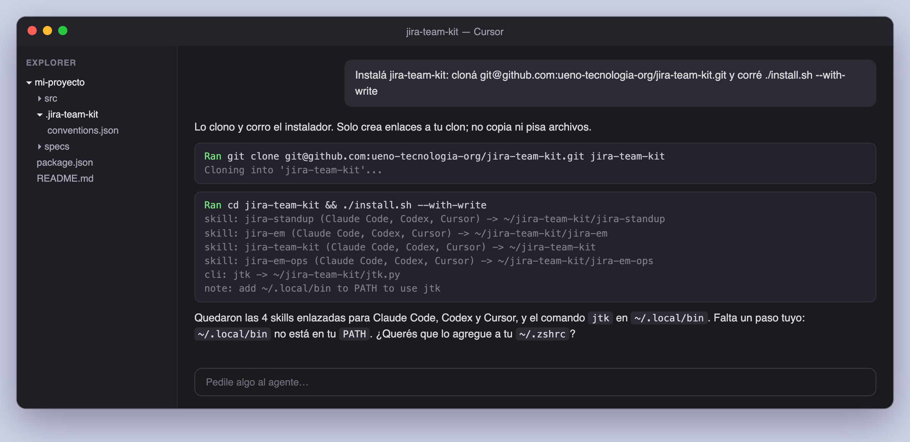
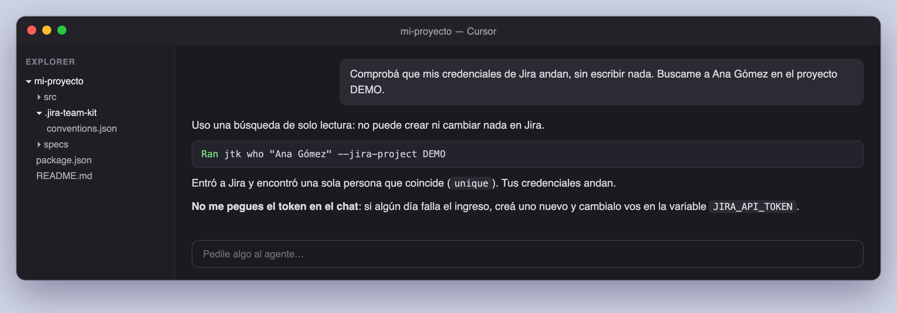
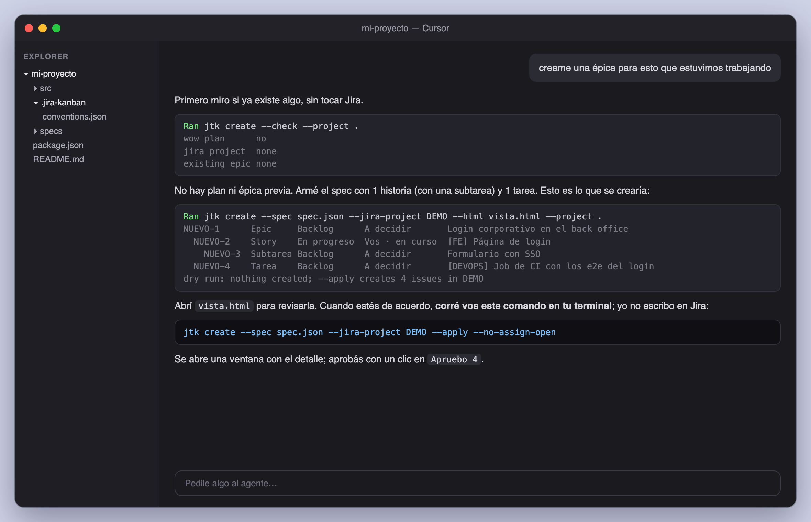
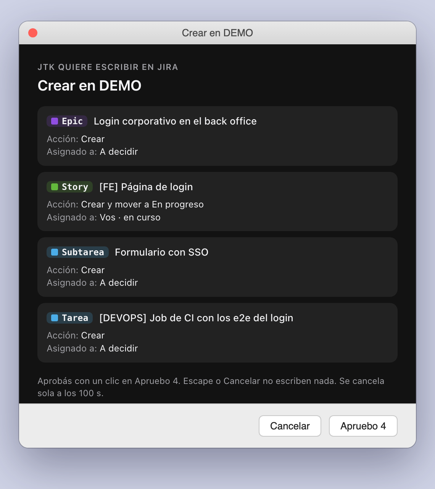
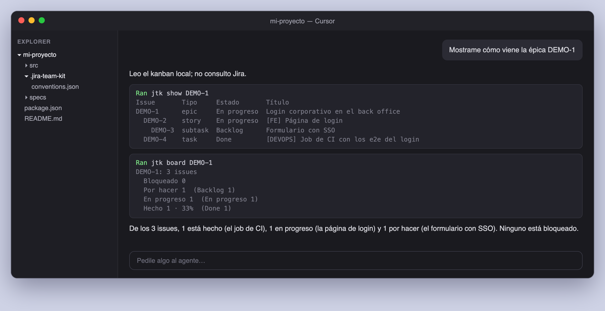
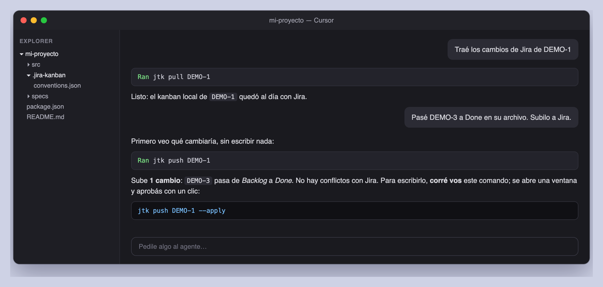
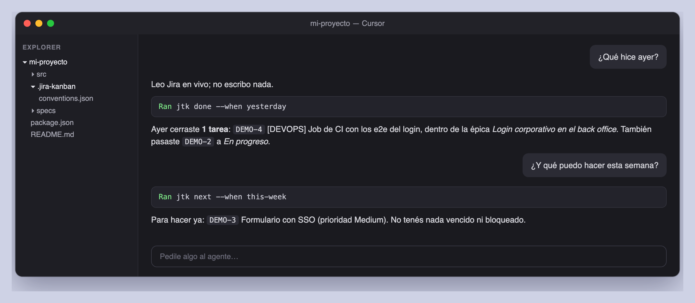
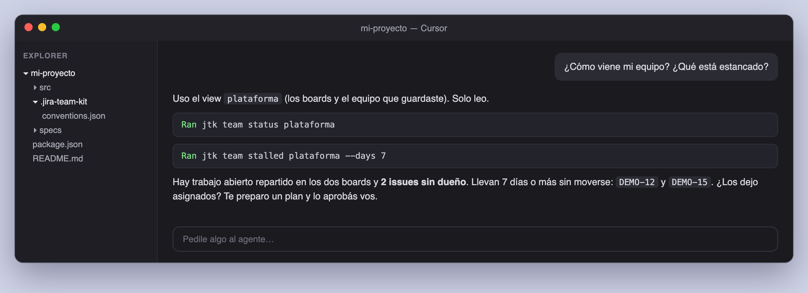
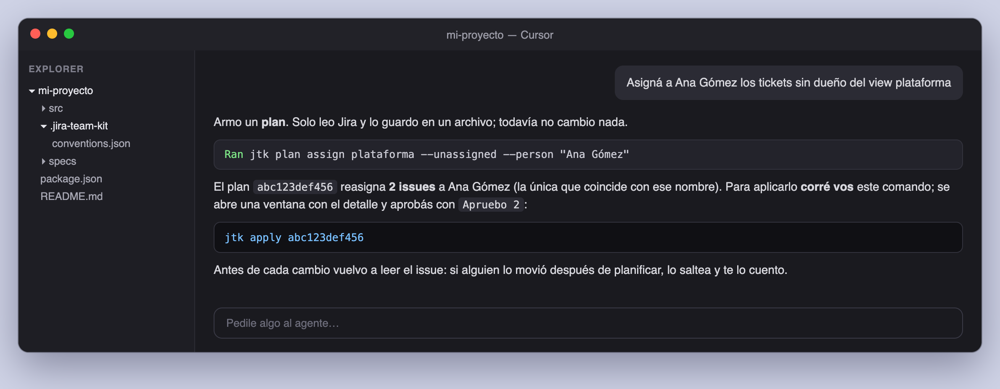
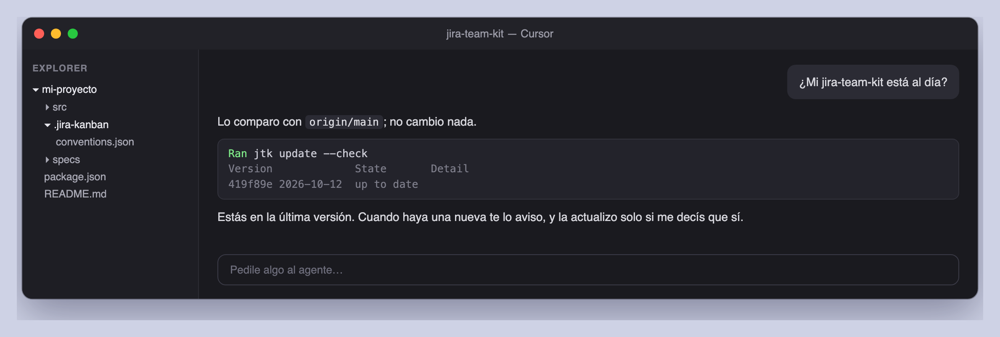

# Instalación y primer uso, desde Cursor

Todo esto se hace conversando con el agente de Cursor: no hace falta aprender ningún comando. Le pedís las cosas y él
corre `jtk` por vos. Dos pasos **no** son un prompt, y es a propósito:

- **El token de Jira** es un secreto: lo creás y lo guardás vos, y nunca lo pegues en el chat.
- **La aprobación de lo que se escribe en Jira** es un clic tuyo en una ventana, no una respuesta del agente.

> ¿Preferís ver (o correr) cada comando? Está la [instalación detallada](instalacion-detallada.md), con los comandos
> uno por uno. Para ver todo lo que hace la herramienta, el [showcase](showcase.md).

| Paso | Qué hacés | Cómo |
|---|---|---|
| [1. Instalar](#1-instalar) | Dejar las skills y `jtk` andando | Un prompt |
| [2. Credenciales de Jira](#2-credenciales-de-jira) | Crear un token y comprobar que entra | Manual + un prompt |
| [3. Tu primera épica](#3-tu-primera-épica) | Pedirle al agente que la arme | Un prompt + un clic |
| [4. Ver cómo viene y sincronizar](#4-ver-cómo-viene-y-sincronizar-con-jira) | Mirar la épica y subir o traer cambios | Prompts |
| [5. Reportes y cambios en lote](#5-reportes-y-cambios-en-lote) | Qué hiciste, cómo viene el equipo, reasignar | Prompts |
| [6. Mantenerlo al día](#6-mantenerlo-al-día) | Saber si hay una versión nueva | Un prompt |

> **Sobre las capturas.** Son **maquetas** de Cursor: muestran cómo se ve la conversación, no una sesión grabada, y el
> texto del agente es ilustrativo. Los bloques `Ran` de los pasos 1, 4 (estado) y 6 reproducen la salida real de esos
> comandos; el resto de las salidas no se muestran porque dependen de tu Jira. La ventana de aprobación sí es la real.
> [Tabla con el origen de cada imagen](#de-dónde-sale-cada-captura).

---

## 1. Instalar

Necesitás `python3` 3.9 o más, `git` y acceso por SSH a `josefigueredo` (el repo es privado). Abrí cualquier
carpeta en Cursor y pedile:

> Instalá jira-team-kit: cloná git@github.com:josefigueredo/jira-team-kit.git y corré ./install.sh --with-write



*Los dos bloques «Ran» son la salida real del clon y del instalador (rutas acortadas).*

Qué pasó:

- **Cuatro skills** quedaron disponibles en Claude Code, Codex y Cursor: `jira-team-kit` y `jira-em-ops` (escriben en
  Jira, con tu aprobación) y `jira-standup` y `jira-em` (solo lectura). Sin `--with-write` se instalan solo las dos de
  lectura.
- **El comando `jtk`** quedó en `~/.local/bin`. Es lo que el agente usa por detrás.
- **No se copió nada**: son enlaces a tu clon, así que hay una sola fuente de verdad. Instalar de nuevo es seguro y
  nunca pisa un archivo real.

Si el instalador avisa `add ~/.local/bin to PATH to use jtk` (como en la captura), pedile al agente que lo agregue
(«agregá ~/.local/bin al PATH en mi ~/.zshrc») y abrí una terminal nueva.

## 2. Credenciales de Jira

Esto lo hacés vos, en tres tramos.

**a) Creá un token de API.** Entrá a [id.atlassian.com → Seguridad → Tokens de API](https://id.atlassian.com/manage-profile/security/api-tokens),
apretá **Create API token**, poné un nombre y un vencimiento (de 1 a 365 días) y **Copy to clipboard**. Se muestra una sola
vez. [Guía oficial](https://support.atlassian.com/atlassian-account/docs/manage-api-tokens-for-your-atlassian-account/).

> **Creá el token sin alcance: el botón «Create API token», no «Create API token with scopes».** `jtk` entra por la URL
> de tu sitio con tu email y el token. Un token con alcance solo funciona a través de `api.atlassian.com`, que `jtk` no
> usa: con ese token no entra.

**b) Guardá tres variables** en tu `~/.zshrc` (o `~/.bashrc`), con un editor, no por el chat:

```bash
export JIRA_BASE_URL="https://tu-empresa.atlassian.net"   # la URL que ves cuando abrís Jira, sin barra final
export JIRA_EMAIL="vos@tu-empresa.com"                     # el email con el que entrás a Jira
export JIRA_API_TOKEN="el-token-que-copiaste"
```

Después cerrá Cursor del todo y abrilo de nuevo. Si más adelante el agente dice que no encuentra las credenciales,
casi seguro Cursor se abrió antes de que las variables existieran.

**c) Comprobá que entran, sin escribir nada.** Pedile:

> Comprobá que mis credenciales de Jira andan, sin escribir nada. Buscame a Ana Gómez en el proyecto DEMO.



*Maqueta. Cambiá «Ana Gómez» y «DEMO» por una persona y un proyecto tuyos.*

Es una búsqueda de solo lectura. Si el token vence, `jtk` deja de poder entrar: creá otro en el mismo link y cambiá la
variable `JIRA_API_TOKEN`.

## 3. Tu primera épica

Pedile lo que ya hiciste o lo que vas a hacer:

> creame una épica para esto que estuvimos trabajando



*Los bloques «Ran» son salida real; la conversación es una maqueta.*

El agente hace cuatro cosas, en este orden, y **hasta la cuarta no escribe nada en Jira**:

1. **Mira si ya existe algo** (un plan o una épica para este trabajo). Si existe, te pregunta antes de crear otra.
2. **Arma el spec**: la épica, sus historias, tareas y subtareas, cada una con su *por qué*, su *qué* y su *hecho cuando*.
3. **Te muestra qué se crearía**: una tabla y una página `vista.html` con la forma de una pantalla de Jira. Abrila y
   revisala.
4. **Te pasa el comando para crear** y lo corrés vos, en tu terminal. El agente no escribe en Jira.

Al correr ese comando se abre una ventana con el detalle exacto:



*La ventana real de `jtk` (los botones son una maqueta).*

- **Aprobás con un clic en `Apruebo 4`**; el número es la cantidad de issues. Return no aprueba.
- **Cancelar** (o Escape, o cerrar la ventana, o esperar 100 segundos) no escribe nada.
- Si hay issues sin terminar, el agente te va a preguntar si te los asignás a vos o los dejás sin asignar.
- Si Jira rechaza algo a mitad de camino, lo creado se conserva y repetir el mismo comando retoma sin duplicar.

## 4. Ver cómo viene y sincronizar con Jira

Al crear, la épica queda como carpetas y archivos en `./.jira-team-kit/` de tu proyecto. Para verla:

> Mostrame cómo viene la épica DEMO-1



*Los bloques «Ran» son salida real, sobre un kanban de prueba.*

Para traer lo que cambió en Jira y subir lo que cambiaste vos:

> Traé los cambios de Jira de DEMO-1
>
> Pasé DEMO-3 a Done en su archivo. Subilo a Jira.



*Maqueta.*

Subir cambios es una escritura: el agente te muestra qué cambiaría y te pasa el comando, que corrés vos y aprobás con
el mismo clic. **Si alguien cambió el mismo campo en Jira, no se pisa**: el agente te avisa del conflicto, trae los
cambios de Jira y vuelve a aplicar el tuyo.

## 5. Reportes y cambios en lote

Los reportes leen Jira en vivo y **no escriben nada**. Preguntá como le preguntarías a un compañero:

> ¿Qué hice ayer?
>
> ¿Y qué puedo hacer esta semana?



*Maqueta con datos de ejemplo.*

| Le decís… | Para qué sirve |
|---|---|
| «¿Qué hice ayer?» / «la semana pasada» | Tu daily o tu resumen |
| «¿Qué puedo hacer esta semana?» | Planificar |
| «¿En qué estoy bloqueado?» | Ver bloqueos por link, por bandera o por estado |
| «¿Qué tan cargada está Ana?» | Antes de asignarle algo |

Si seguís varios boards y un equipo, hay reportes de equipo (necesitan guardar antes el equipo y los boards, una sola vez):

> ¿Cómo viene mi equipo? ¿Qué está estancado?



*Maqueta con datos de ejemplo.*

Y si hay que **cambiar varios issues a la vez**, el agente arma un plan sin escribir nada, y una persona lo aprueba:

> Asigná a Ana Gómez los tickets sin dueño del view plataforma



*Maqueta.*

Antes de cada cambio se vuelve a leer el issue: si alguien lo movió o reasignó después de planificar, **se saltea y se
te informa**. Un plan cambia hasta 25 issues por vez. Mover issues a «entregado» o «descartado» exige confirmarlo
expresamente.

## 6. Mantenerlo al día

> ¿Mi jira-team-kit está al día?



*El bloque «Ran» es salida real.*

Si hay una versión nueva, el agente te la cuenta y la actualiza **solo si le decís que sí**. Si el clon está en otra rama
que `main` o no hay red, la respuesta es «no sé» (`unknown`), no un error.

## Si algo falla

| Qué pasa | Qué hacer |
|---|---|
| El agente dice que `jtk` no existe | `~/.local/bin` no está en el `PATH`. Pedile que lo agregue a tu `~/.zshrc` y abrí una terminal nueva |
| «No encuentro las credenciales» | Cerrá Cursor del todo y abrilo de nuevo; si sigue, revisá las tres variables (paso 2b) |
| No entra con un token recién creado | Casi seguro lo creaste **con alcance**. Creá otro con el botón sin alcance |
| La ventana no aparece, o el comando termina sin escribir | No hay ventana (no es macOS, estás por `ssh` o sin sesión gráfica), o la cancelaste o pasaron 100 s. Si no hay ventana, el comando imprime la línea para copiar y correr en una terminal real |
| El agente dice que falta un campo del spec | Pedile que complete el *por qué*, el *qué* y el *hecho cuando* de ese issue |
| Una actualización dice «no sé» | El clon no está en `main` o no hay red |

## De dónde sale cada captura

| Imagen | Origen |
|---|---|
| `cursor-instalar.png` | Maqueta. Los bloques `Ran` son la salida real del clon y de `./install.sh --with-write` |
| `cursor-estado.png` | Maqueta. Los bloques `Ran` son la salida real de `jtk show` y `jtk board` sobre un kanban de prueba |
| `cursor-actualizar.png` | Maqueta. El bloque `Ran` es la salida real de `jtk update --check --fresh` |
| `cursor-chat.png` | Maqueta. Los bloques `Ran` reproducen la salida real de `create --check` y del dry run |
| `cursor-credenciales.png`, `cursor-sincronizar.png`, `cursor-reportes.png`, `cursor-equipo.png`, `cursor-lote.png` | **Maqueta completa**: comandos y respuestas ilustrativos, con datos de ejemplo. Dependen de tu Jira |
| `ventana-aprobacion.png` | HTML real de la ventana de `jtk`; los botones nativos son una maqueta |

Las fuentes de cada captura están en [`img/src/`](img/src/), por si hay que regenerarlas.
