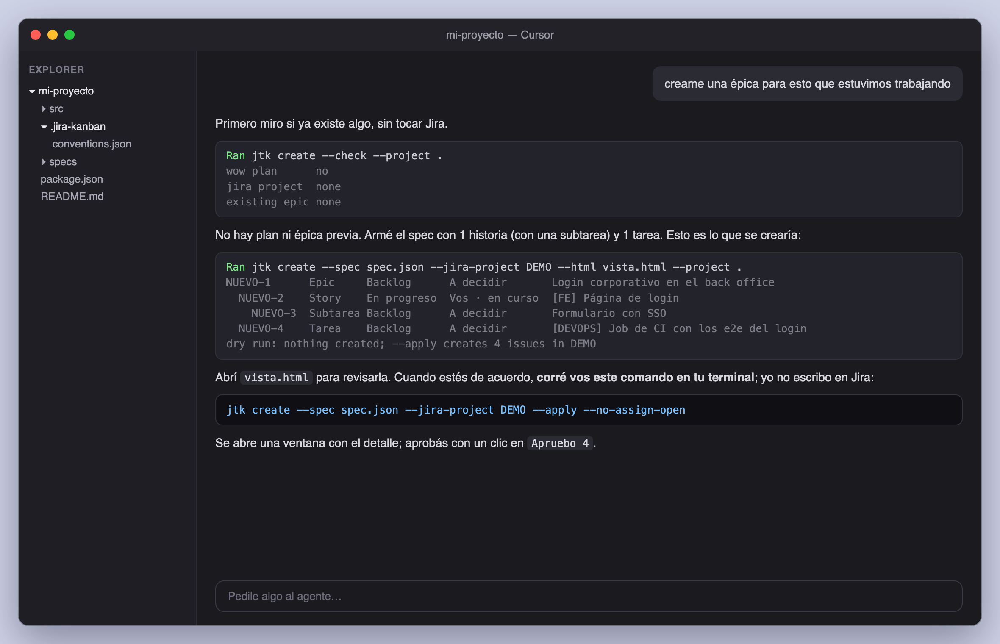
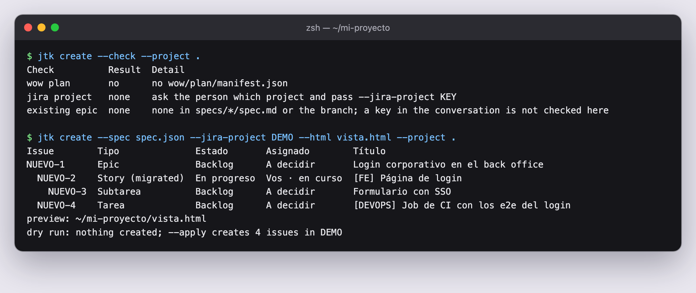
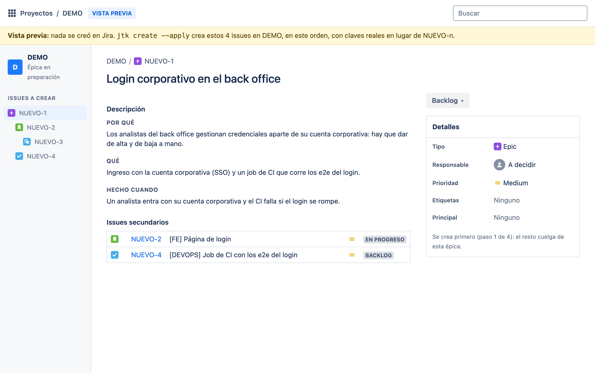
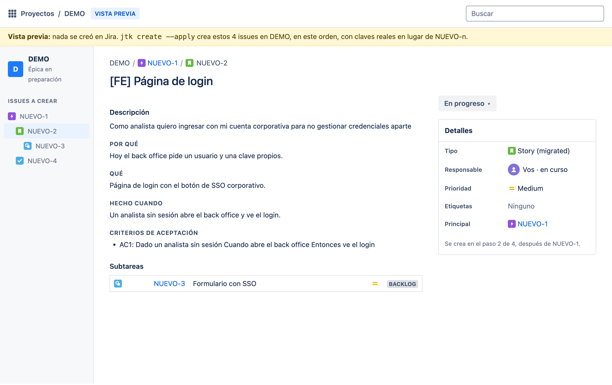
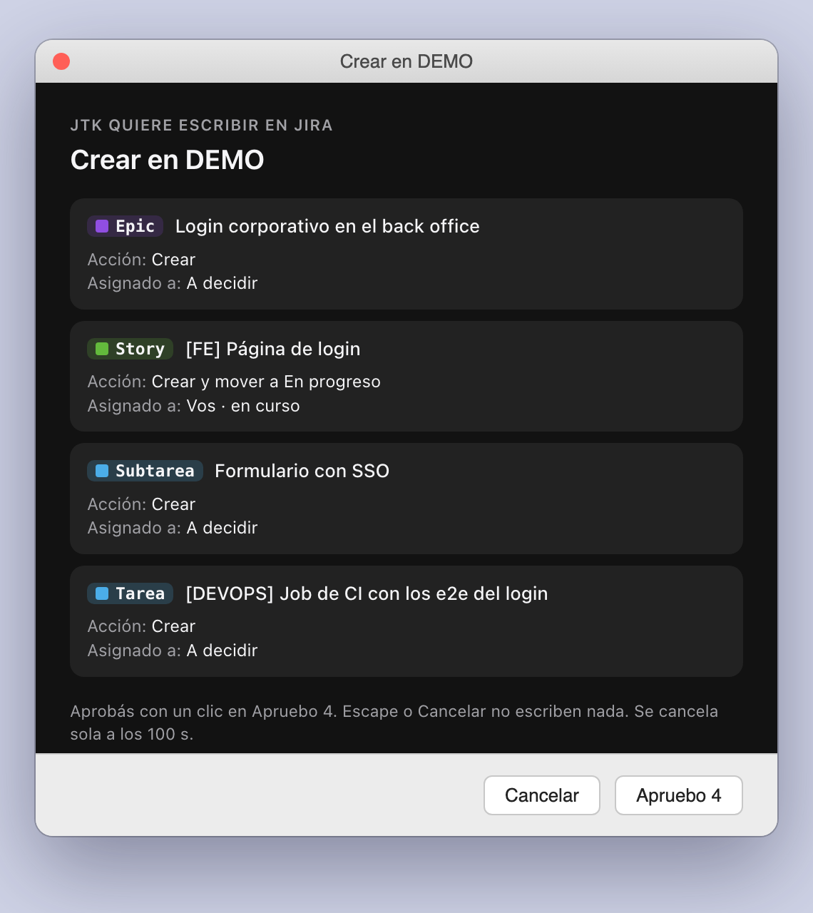
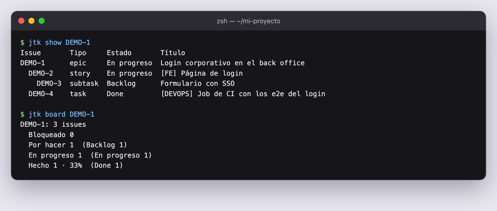

# Showcase

Qué se puede hacer con `jira-team-kit`, escenario por escenario: qué le decís al agente, qué comandos corre por detrás y
qué ves en pantalla. Para instalarlo, la [guía de instalación](instalacion.md) (con prompts de Cursor) o la
[detallada](instalacion-detallada.md) (con comandos); para cada comando y flag, la [referencia](referencia.md).

| Skill | Escenario | Ir al caso |
|---|---|---|
| `jira-team-kit` | «Creame una épica para esto que estuvimos trabajando» | [Crear una épica](#1-crear-una-épica-desde-la-conversación) |
| `jira-team-kit` | Editar tarjetas en archivos y subirlas a Jira | [Kanban local](#2-un-kanban-local-que-se-sincroniza-en-los-dos-sentidos) |
| `jira-standup` | «¿Qué hice ayer?», «¿qué puedo hacer esta semana?» | [Reportes personales](#3-qué-hice-qué-puedo-hacer-qué-me-bloquea) |
| `jira-em` | «¿Cómo viene mi equipo?», «¿qué está estancado?» | [Reportes de equipo](#4-cómo-viene-el-equipo) |
| `jira-em-ops` | «Pasá estos tickets a en curso», «asigná los que no tienen dueño» | [Cambios en lote](#5-cambiar-varios-issues-con-aprobación-humana) |

> **Sobre las salidas.** Los casos 1 y 2 muestran salida real de `jtk` sobre un proyecto de prueba, sin credenciales.
> Los casos 3 a 5 leen o escriben en **tu** Jira, con nombres y claves de tu equipo, así que acá aparecen el comando y
> lo que responde, sin tablas inventadas. La captura de Cursor es una maqueta.

---

## Lo que lo distingue

| | |
|---|---|
| **Dry run por defecto** | Ningún comando escribe en Jira sin `--apply`. Antes de aplicar, la consola, la página HTML y la ventana muestran los mismos datos: mismas claves, mismo estado final, mismo responsable |
| **Aprobación humana con un clic** | `--apply` abre una ventana nativa de macOS con el detalle. Solo responde a un clic en `Apruebo <n>`; Return no aprueba y Cancelar es el predeterminado. El agente no puede aprobar por vos |
| **Evidencia de lo hecho** | Un issue marcado `done` exige commits mergeados o URLs; `jtk` los resuelve antes de escribir y los deja como permalinks en la descripción |
| **Forma fija de los issues** | Todo issue sale con *Por qué*, *Qué* y *Hecho cuando*; la historia, además, con «Como … quiero … para …» y criterios en Gherkin |
| **Espejo local** | Un kanban en `./.jira-team-kit/` que se trae (`pull`) y se sube (`push`), sin pisar cambios ajenos |
| **Registro** | Cada escritura queda en `./.jira-team-kit/jira-writes.jsonl` y en `~/.local/state/jtk/writes.jsonl` |

---

## 1. Crear una épica desde la conversación

**Skill:** `jira-team-kit` · **Escribe en Jira:** sí, con tu aprobación.

Terminaste de trabajar y querés dejar el trabajo registrado, o vas a empezar algo y querés planificarlo en Jira.



*Maqueta de la conversación; los dos bloques «Ran» son salida real.*

### Qué corre el agente

| # | Comando | Para qué | ¿Escribe en Jira? |
|---|---|---|---|
| 1 | `jtk create --check --project .` | Ver si hay un plan de WayOfWork, qué proyecto aplica y si ya existe una épica | No (offline) |
| 2 | *(arma `spec.json`)* | Épica, historias, tareas y subtareas, cada una con `why`, `what` y `done_when` | No |
| 3 | `jtk create --spec spec.json --jira-project KEY --html vista.html` | Dry run: tabla de lo que se crearía y la página de vista previa | No |
| 4 | `jtk create --spec spec.json --jira-project KEY --apply --no-assign-open` | Crear. **Lo corrés vos** | Sí, tras tu clic |

### Lo que ves en la terminal



Cuatro issues: la épica, una historia con una subtarea y una tarea. La historia `[FE] Página de login` figura
**En progreso** y asignada a *Vos · en curso* porque el spec la marcó `started`; el resto queda en Backlog, con el
responsable **A decidir** hasta que elijas `--assign-open` o `--no-assign-open`.

### La vista previa: se ve como Jira

La página es una sola, sin red ni recursos externos. Árbol de issues a la izquierda, breadcrumb, descripción con las tres
secciones, tabla de hijos, estado y panel de detalles:



Navegás a cada issue con el árbol; acá, la historia:



### La ventana de aprobación



Una tarjeta por issue con **qué se va a hacer** y **a quién queda asignado**. Fijate que la historia dice
`Crear y mover a En progreso`: crear y mover son dos escrituras, y las dos figuran antes de que aprobes.

**Qué pasa si algo sale mal**

| Situación | Resultado |
|---|---|
| Cancelás, cerrás la ventana o pasan 100 s | No se escribe nada; el comando sale con código `3` |
| Jira rechaza un issue a mitad de camino | Se conserva lo creado; **el mismo comando retoma sin duplicar** |
| Falla solo un cambio de estado | Sigue con los demás, escribe el kanban y lo informa; se termina con `push`, nunca repitiendo `create` |
| Falta un campo en el spec | El dry run lo dice antes de tocar nada |
| Un `evidence` no resuelve | `create` no escribe nada |

### Asignar a otra persona

El spec puede nombrar a quien corresponda con `"assignee"`. `jtk` la busca **mientras planifica**, también en el dry run:

```bash
jtk who "Matias" --jira-project KEY            # solo lectura: unique, ambiguous o none
jtk assign KEY-639 "Nombre Apellido" --tree    # dry run; con --apply, la ventana
```

Si el nombre coincide con varias personas, lista a los candidatos con su email y **nunca elige entre dos**. Tolera
tildes, mayúsculas y una letra de diferencia («Matiaz» encuentra a «Matías»).

---

## 2. Un kanban local que se sincroniza en los dos sentidos

**Skill:** `jira-team-kit` · **Escribe en Jira:** solo con `push --apply`.

Después de `create`, la épica queda como carpetas y archivos Markdown en tu proyecto:

```text
.jira-team-kit/DEMO-1/epic.md
.jira-team-kit/DEMO-1/stories/DEMO-2/story.md
.jira-team-kit/DEMO-1/stories/DEMO-2/subtasks/DEMO-3/subtask.md
.jira-team-kit/DEMO-1/tasks/DEMO-4/task.md
```



*Salida real sobre un kanban de prueba. `show` lista el árbol; `board` agrupa por la categoría fija que Jira le da a cada
estado, nunca por el nombre de la columna (que cambia entre tableros).*

### El ciclo

| Querés… | Hacé | Comando |
|---|---|---|
| Traer lo que cambió en Jira | `pull` | `jtk pull DEMO-1` |
| Cambiar un estado, un título o un cuerpo | Editá el `.md` (`status`, `# título`, texto) | — |
| Ver qué subiría | Dry run | `jtk push DEMO-1` |
| Subirlo | Con ventana de aprobación | `jtk push DEMO-1 --apply` |
| Agregar una subtarea | Creá `…/subtasks/_new-<algo>/subtask.md` | `jtk push DEMO-1 --apply` |

**Conflictos:** si el mismo campo cambió también en Jira desde el último `pull`, `push` lo informa y **no lo pisa**.
Hacés `jtk pull`, volvés a aplicar tu cambio y repetís el `push`.

**Bloqueado no es una categoría de Jira:** un issue lo está si su estado figura en `blocked_statuses` o si tiene la
bandera *Flagged*. Uno en *Hecho* sigue contando como hecho aunque tenga la bandera.

---

## 3. Qué hice, qué puedo hacer, qué me bloquea

**Skill:** `jira-standup` · **Solo lectura.**

Para el daily, el 1:1 o planificar la semana. Le preguntás en lenguaje natural; el agente traduce «ayer» o «la semana
pasada» a una ventana y la CLI hace el calendario (lunes a domingo, en la zona del equipo).

| Le decís… | Corre | Responde |
|---|---|---|
| «¿Qué hice ayer?» | `jtk done --when yesterday` | Árbol Épica → Historia/Tarea → Subtarea, con totales |
| «¿Qué puedo hacer esta semana?» | `jtk next --when this-week` | Para hacer ya (por prioridad y vencimiento), lo que vence, lo que está sin dueño en tus épicas |
| «¿Dónde estoy bloqueado?» | `jtk blocked` | Bloqueos por link «is blocked by», por Flagged o por estado |
| «¿Qué tan cargada está Ana?» | `jtk load --person "Ana" --weeks 4` | La carga de Ana en números medidos, al lado de la tuya |
| «¿Cómo vamos de velocidad?» | `jtk stats --weeks 6 --by label` | Cerrados por semana, lead time, edad del WIP, cumplimiento de fechas, mezcla |

Ventanas válidas: `today`, `yesterday`, `this-week`, `last-week`, `this-month`, `last-month` y, para `next`,
`next-week`. Para otro rango, `--since` y `--until` en `YYYY-MM-DD`. Todos aceptan `--json`.

**Qué conviene saber:** el proyecto PLATE no tiene story points, así que la velocidad se mide en issues; Jira guarda solo
el último cambio de estado (un issue que pasó por «en curso» y luego a Done figura con la fecha de Done); y «hecho»
significa asignado a la persona.

---

## 4. Cómo viene el equipo

**Skill:** `jira-em` · **Solo lectura.** Para quien sigue varios boards y un equipo (EM, Sr EM).

Primero se guarda un **view**: los boards y el equipo. Cada board necesita su perfil (qué estado significa «hecho» en
ese proyecto):

```bash
jtk board setup PLATE                       # propone un rol por estado; vos confirmás
jtk team setup plataforma --boards PLATE,UA --group team
```

Después, las preguntas:

| Le decís… | Corre | Responde |
|---|---|---|
| «¿Cómo viene mi equipo?» | `jtk team status plataforma` | Trabajo abierto por rol, por board y por persona; lo que nadie tiene |
| «¿Qué está estancado?» | `jtk team stalled plataforma --days 7` | Lo activo que lleva N días o más sin cambiar de categoría |
| «¿Qué está bloqueado?» | `jtk team blocked plataforma` | Bloqueado (rol, flag o link) y, aparte, lo que espera a un tercero |
| «Resumen de la semana» | `jtk team digest plataforma --when last-week` | Entregado, descartado y nuevo, más lo bloqueado y estancado de hoy |
| «¿Cómo anda la mesa de ayuda?» | `jtk team desk helpdesk` | Antigüedad de lo abierto, sin asignar, esperando y tiempo de resolución |
| «¿Cómo andan mis equipos?» | `jtk team rollup plataforma datos` | Una fila por view: abiertos, bloqueados, estancados, entregados, lead time p85 |

Cada reporte abre con el view, los boards, el equipo y la ventana; muestra el `n` de cada número; corta las tablas en 20
filas con un `… y N más`; y cierra con **Límites**. Con `--list` pasás de «7 sin asignar» a **cuáles son**.

---

## 5. Cambiar varios issues, con aprobación humana

**Skill:** `jira-em-ops` (se instala con `./install.sh --with-write`) · **Escribe en Jira, con tu clic.**

De «7 sin asignar» a «asignados», en dos pasos. El primero lo hace el agente y no escribe; el segundo **solo lo hace una
persona**.

| Paso | Comando | Qué hace |
|---|---|---|
| 1 | `jtk plan assign plataforma --unassigned --person "Ana"` | Arma un plan y lo guarda con las claves, el estado de origen y el de destino. Solo lee Jira |
| 1 | `jtk plan move plataforma --role todo --to active` | Plan para mover issues al estado que cumple ese rol |
| 1 | `jtk plan comment plataforma KEY-1 KEY-2 --text "…"` | Plan para dejar el mismo comentario |
| 1 | `jtk plan parent plataforma KEY-1 KEY-2 --to KEY-9` | Plan para mover issues a otra épica |
| 2 | `jtk apply <ID>` | Aplica **exactamente** ese plan: abre la ventana con el detalle y **Apruebo n** |
| 1 | `jtk plan link plataforma KEY-1:KEY-2 KEY-1:KEY-3` | Plan para decir qué issue bloquea a cuál |
| — | `jtk plan revert <ID>` | Plan inverso de uno aplicado (no garantiza deshacer, y lo dice) |

**Qué protege:** un plan lleva hasta 25 issues (`--max`, hasta 200); mover a `delivered` o `dropped` exige
`--allow-close`; la persona nunca se adivina; y antes de cada escritura `apply` vuelve a leer el issue: si alguien lo
movió o reasignó después de planificar, **lo saltea y lo informa**. Reaplicar un plan es seguro.

**Qué no protege** (dicho sin vueltas): frena el error y las instrucciones inducidas, porque la respuesta la da un clic
humano. **No protege de un agente malicioso con control total de la máquina**, y si le diste permiso de accesibilidad a
Cursor o a Terminal, esa defensa se debilita. En Claude Code, además, un hook bloquea los rodeos de la ventana.

---

## Frente al MCP de Atlassian

Si en Cursor escribís «jira», te sugiere el MCP de Atlassian. Se pisan solo en el CRUD básico. La comparación completa
(registro local, ventana de aprobación, kanban espejo, costo y acceso) está en la
[referencia](referencia.md#frente-al-mcp-de-atlassian). La recomendación no cambia: **no instales el MCP de Atlassian
junto a esta skill**, porque sus herramientas de escritura se saltean la ventana.
